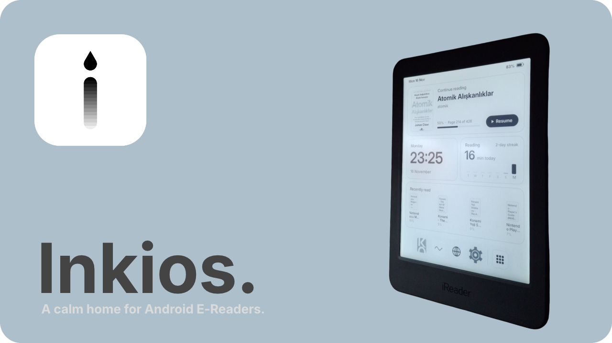
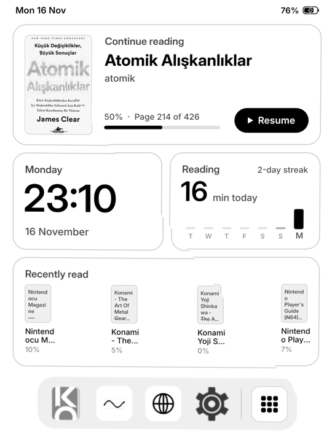
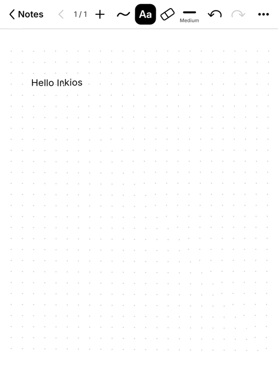
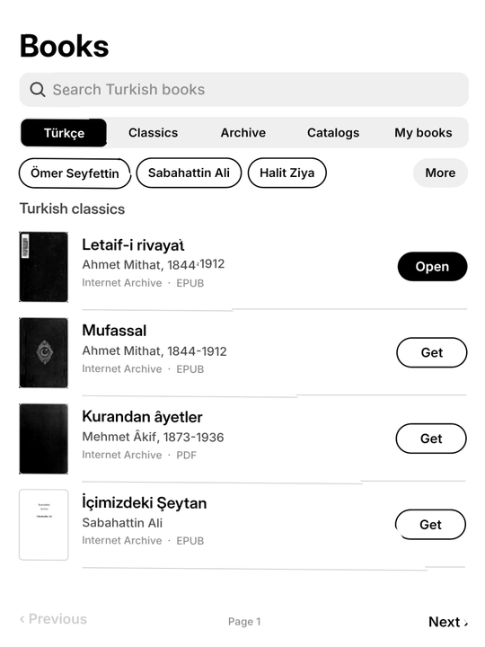
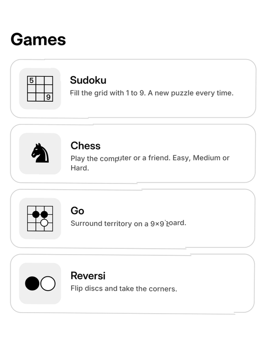
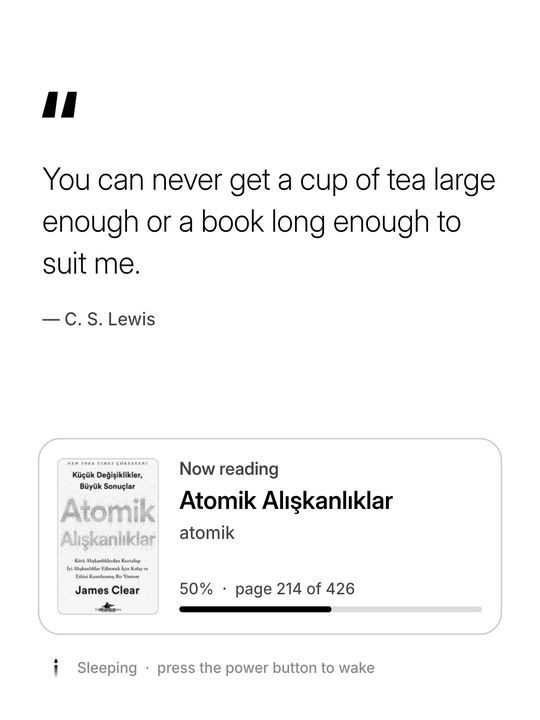

# Inkios



A calm, iPadOS-inspired home for Android e-readers. Designed for e-ink first.

Inkios turns an old Android e-reader into a reading tablet: a home screen built around the book you're reading, plus a small family of apps (Notes, Books, Browser, Share and Games) that all talk to the e-paper controller directly, so every part of the screen refreshes with the right waveform.

# Contents

- [About](#about)
- [Features](#features)
- [Installation](#installation)
- [Usage](#usage)
- [Repository Contents](#repository-contents)
- [How it works](#how-it-works)
- [Build](#build)
- [Troubleshooting](#troubleshooting)
- [Future Plans](#future-plans)
- [License](#license)
- [Contact](#contact)
- [Support](#support)

# About

Inkios was built on (and for) an **iReader R6801**: a 6.8" e-reader with Android 4.4, a single 1 GHz core and an NXP i.MX 6SoloLite e-paper controller. Its stock software was in Chinese and slow, and modern apps don't run on Android 4.4 anymore. So everything here is written from scratch for that kind of hardware:

- Targets **Android 4.4 (API 19)** and up, written in plain Java, with no AndroidX.
- Every screen is drawn on a canvas, with no animations, paging instead of scrolling, and colours snapped to the 16 greys an e-ink panel can show.
- Device-specific features (e-ink waveforms, the light button, the boot and sleep screens) are detected at runtime, so the apps still run on other devices.

The repository is one Gradle project that builds six apps:

| App | What it does |
|---|---|
| **Inkios** | Home screen: Continue Reading, reading stats, clock, Recently Read shelf, dock, App Library, Recent apps |
| **Notes** | Handwritten notes with fast A2 ink, text blocks, pages and page styles |
| **Books** | Free and legal books: Internet Archive (Turkish and all), Vikikaynak, Project Gutenberg, any OPDS catalog |
| **Browser** | The system WebView with modern TLS underneath, e-ink page styling and a paginated Reader mode |
| **Share** | Scan a QR code with your phone and send books to the e-reader over Wi-Fi |
| **Games** | Sudoku, Chess, Go (9×9) and Reversi |

# Features



## Home screen
- **Continue Reading** with the real book cover, progress and a Resume button (opens KOReader).
- **Reading widget:** minutes read today, a 7-day chart and your streak, from KOReader's statistics.
- **Clock widget** that updates every minute without flashing the screen.
- **Recently Read** shelf, floating **dock** and a paged **App Library**.
- **Recent apps** screen, and **light-button gestures** on iReader: press = light, hold = Home, double press = Recent apps.
- **Dynamic sleep screen:** a rotating quote, fun fact or little joke (English and Turkish), and the book you're reading.
- Boot animation, sleep, shutdown and battery screens drawn from the Inkios logo (rooted iReader devices).

## E-ink engine
| Situation | Waveform | Why |
|---|---|---|
| Returning home | GC16 full | Wipes ghosting left by other apps |
| Tap feedback | DU, pressed region only | ~100 ms, no flash |
| Clock and status bar | GL16 partial | Updates text without flashing |
| Pen strokes | A2, touched pixels only | As fast as the panel can go |
| Page changes | GC16 partial | Clean, only where content changed |

Requests are clamped to the screen and coalesced, because the i.MX EPDC driver can deadlock when refreshes pile up.



## Notes
- Live ink in the A2 waveform, smoothed strokes stored as vectors.
- Three pen widths, stroke eraser, undo and redo, two-finger tap to undo.
- Text blocks (regular or bold) on the page.
- Multiple pages per note and four page styles: dots, lines, grid, blank.
- Plain files in `/sdcard/Inkios/Notes`, easy to copy to a computer.



## Books
- Tabs: **Türkçe**, **Classics**, **Archive**, **Catalogs** (OPDS, e.g. your Calibre library) and **My books**.
- Author and genre chips, so you rarely need to type.
- Detail page with cover, format, size and description, an App Store style **Get** button, then **Open** in KOReader.
- Opens instantly from a cache, covers cached on disk.

## Browser
- Every request goes through modern TLS (Conscrypt), because Android 4.4's own TLS can't reach most servers anymore.
- Pages get a phone-width layout, high contrast, black underlined links and no animations.
- A swipe turns one screen. In **Reader mode**, pages always end on a whole line, like a printed book.
- Quick toggles for text size, layout, images and scripts, plus Favorites and Recent pages.
- Book downloads go straight to the Books folder.

## Share
- Shows a QR code. Scan it with your phone, or type the address on a computer.
- Upload page with progress per file, plus Save and Delete for books already on the device.
- Works only on your Wi-Fi, protected by a random key in the QR link.



## Games
- **Sudoku:** a new puzzle every time with exactly one solution, notes, hints and undo.
- **Chess:** full rules (perft-verified), against the computer at three levels or a friend.
- **Go 9×9:** captures, ko, passing and area scoring.
- **Reversi** against the computer.
- Every game is saved automatically.

# Installation

You need an Android e-reader (or any Android device) with **Android 4.4 or newer**.

1. Download the APKs from the [Releases](https://github.com/MYusufY/inkios/releases) page, or [build them yourself](#build).
2. Install the ones you want:
   `adb install -r Inkios-0.1.0.apk` (and the same for Notes, Books, Browser, Share, Games)
3. Press Home and choose **Inkios** → **Always**.
4. Optional, for the light-button gestures: enable **Inkios light button** in Settings → Accessibility, or:
   `adb shell settings put secure enabled_accessibility_services tech.tachion.inkios/tech.tachion.inkios.system.KeyService`
   `adb shell settings put secure accessibility_enabled 1`

The home screen works best with [KOReader](https://github.com/koreader/koreader) installed: Continue Reading, the reading widget and Recently Read all come from KOReader's data.

## Boot and sleep screens (rooted iReader)



These need a root adb shell (the iReader R6801 ships with one).

1. `python3 branding/generate.py` -> Renders the artwork into `branding/out/` (needs Pillow).
2. `tools/install-branding-ireader.sh` -> Backs up the originals, then installs the boot animation and the sleep, shutdown and battery screens.
3. `tools/enable-dynamic-sleep-ireader.sh` -> Switches the sleep image to the dynamic one (quote / fact / joke + your book).

Both scripts take `--restore` to put things back.

# Usage

- **Home:** tap Resume to continue your book, swipe left (or tap the grid in the dock) for the App Library. Tap the status bar to clean the screen.
- **Light button (iReader):** press to toggle the light, hold to go Home, press twice for Recent apps.
- **Notes:** tap "New note", write with a finger or a capacitive stylus. Tap the width button for Fine / Medium / Bold, "Aa" for text.
- **Books:** pick a tab, tap a chip or search, tap a book for details, then **Get**. Downloads land in `/sdcard/Books`.
- **Browser:** tap the address bar to search or type an address, "Aa" for Reader mode, ⋯ for settings. Swipe up or down to turn pages.
- **Share:** open it on the e-reader, scan the code with your phone, choose books.

# Repository Contents

[core/](./core) -> Shared library used by every app.

[core/src/main/java/tech/tachion/inkios/eink/Eink.java](./core/src/main/java/tech/tachion/inkios/eink/Eink.java) -> E-paper waveform control, detected at runtime by reflection, with clamping and coalescing.

[core/src/main/java/tech/tachion/inkios/net/Net.java](./core/src/main/java/tech/tachion/inkios/net/Net.java) -> HTTP with Conscrypt (TLS 1.3, modern ciphers) and bundled root certificates for Android 4.4.

[core/src/main/java/tech/tachion/inkios/ui/](./core/src/main/java/tech/tachion/inkios/ui) -> Design tokens (`Theme`), canvas helpers (`Draw`), touch handling (`TapView`), menus, text fields, status bar and the logo (`InkiosMark`).

[app/](./app) -> Inkios, the home screen: `HomeView`, `LibraryView`, `RecentsActivity`, KOReader data readers, the light-button service and the sleep screen renderer.

[notes/](./notes) -> Notes: `InkView` (the writing surface), `Page`/`Stroke` (model and file format), `NoteStore`.

[books/](./books) -> Books: `Sources` (Internet Archive, Vikikaynak, Gutenberg, OPDS), `Library` (downloads, catalogs), `BooksActivity`.

[browser/](./browser) -> Browser: `Fetcher` (requests over modern TLS, page rewriting), `BrowserActivity`, and the injected `page.js` / `page.css` / `reader.js`.

[share/](./share) -> Share: a small HTTP server (`Server`), the QR screen and the upload page (`assets/web/index.html`).

[games/](./games) -> Games: `Chess` (engine), `Sudoku` (generator and solver), the board views and the hub.

[branding/](./branding) -> `logo.py` (the logo construction, SVG and PNG export) and `generate.py` (icons, boot animation, system screens).

[tools/](./tools) -> Device scripts for the boot and sleep artwork.

[licenses/](./licenses) -> Licenses of the bundled fonts.

# How it works

```
Inkios apps --> Eink.refresh(view, rect, mode) --> View.invalidate(l, t, r, b, mode) --> i.MX EPDC driver
Inkios apps --> Net (Conscrypt, TLS 1.3)      --> Internet Archive, Wikisource, Gutenberg, websites
```

- **E-ink:** the iReader firmware adds `View.invalidate(int mode)` methods to Android. Inkios finds them by reflection and picks a waveform per region: A2 for ink, DU for touch feedback, GL16 for text, GC16 for clean repaints.
- **Networking:** Android 4.4 only offers old TLS ciphers and an old root store, so most HTTPS servers refuse it. Every app uses Conscrypt (BoringSSL) plus a few bundled root certificates instead.
- **Browser:** the 2013 WebView renders pages, but every GET request is answered by Inkios over modern TLS through `shouldInterceptRequest`. Forms are sent the same way through a small script.
- **Logo:** an ink drop over a stem made of the 15 grey levels the panel can show, constructed from one unit (r = 60 on a 1024 grid), see [branding/logo.py](./branding/logo.py).

# Build

Requirements: JDK 17+ and the Android SDK (platform 34). The included Gradle wrapper is enough.

1. Clone the repository.
   `git clone https://github.com/MYusufY/inkios.git`
2. Build.
   `./gradlew assembleDebug`
3. The APKs are here:
   - `app/build/outputs/apk/debug/app-debug.apk`
   - `notes/build/outputs/apk/debug/notes-debug.apk`
   - `books/build/outputs/apk/debug/books-debug.apk`
   - `browser/build/outputs/apk/debug/browser-debug.apk`
   - `share/build/outputs/apk/debug/share-debug.apk`
   - `games/build/outputs/apk/debug/games-debug.apk`

For signed release builds, create a `keystore.properties` file in the project folder (it is ignored by git):

```
storeFile=/path/to/your.jks
storePassword=...
keyAlias=...
keyPassword=...
```

Then run `./gradlew assembleRelease`.

# Troubleshooting

- **The app installs but Home still opens the old launcher:** press Home and pick **Inkios** → **Always**.
- **Light-button gestures do nothing:** enable *Inkios light button* in Settings → Accessibility.
- **Books or Browser can't connect:** check Wi-Fi, and the device clock. A wrong date (some e-readers boot in 2016) breaks every secure connection.
- **The screen freezes during heavy refreshes:** this is the i.MX EPDC driver, not the app. Reboot with `adb reboot`, and please open an issue with what was on screen.
- **Search engines in the Browser:** Google, Bing and others block 2013-era web engines. DuckDuckGo works, Vikipedi search is built in.

# Future Plans

- A music app for Bluetooth audio.
- A manual landscape mode.
- Backends for more e-ink controllers (Onyx, Rockchip, Allwinner).

# License

Inkios is licensed under the MIT License.
See the [LICENSE](./LICENSE) file for details.

- Inter and Noto Sans Symbols 2 fonts are licensed under the SIL Open Font License, see [licenses/](./licenses).
- Uses [Conscrypt](https://github.com/google/conscrypt) (Apache 2.0) and [ZXing](https://github.com/zxing/zxing) (Apache 2.0).
- Book sources keep their own terms: [Internet Archive](https://archive.org), [Wikisource](https://wikisource.org) (CC BY-SA), [Project Gutenberg](https://www.gutenberg.org).

# Contact

You can mail at [tachion.software@gmail.com](mailto:tachion.software@gmail.com?subject=Inkios "tachion.software@gmail.com") to contact with me. Thanks!

# Support

You can support me and my projects [here.](https://buymeacoffee.com/myusuf "here.") Any donation is appreciated!
